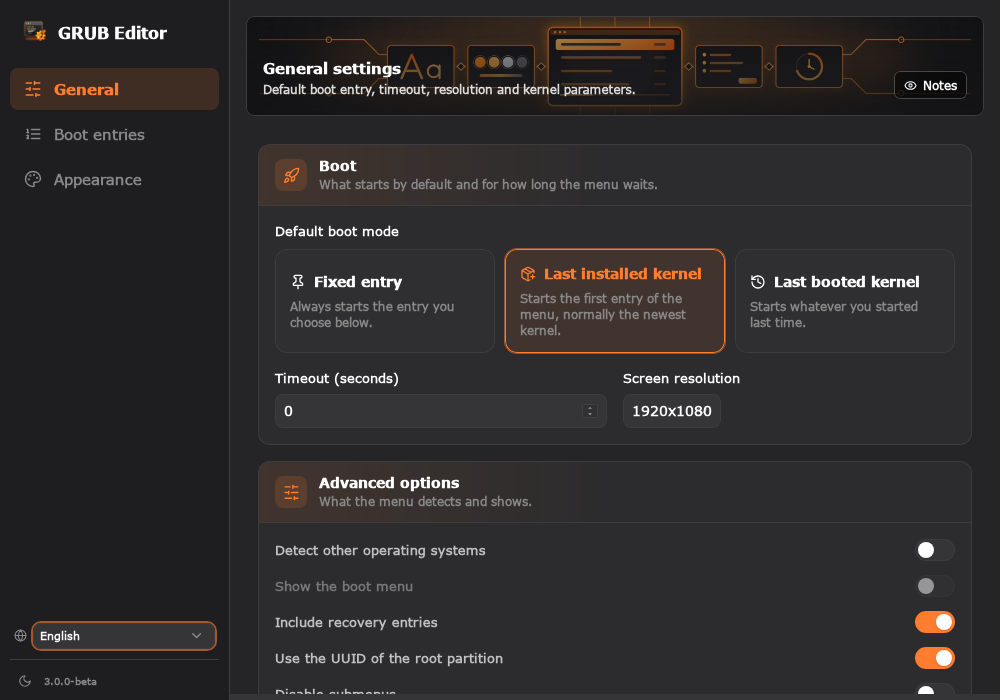
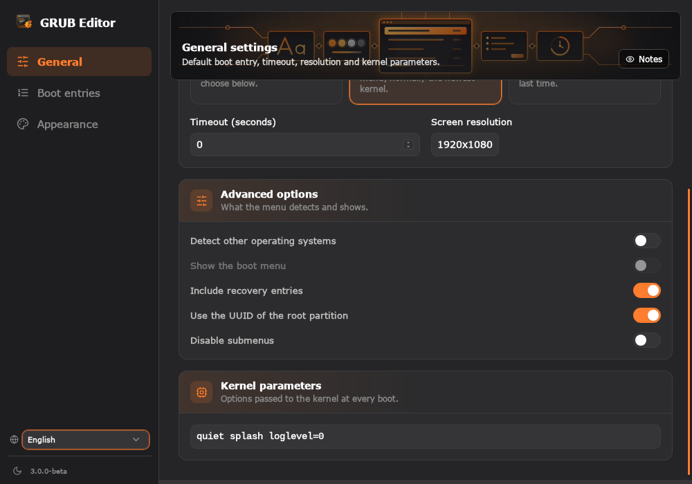
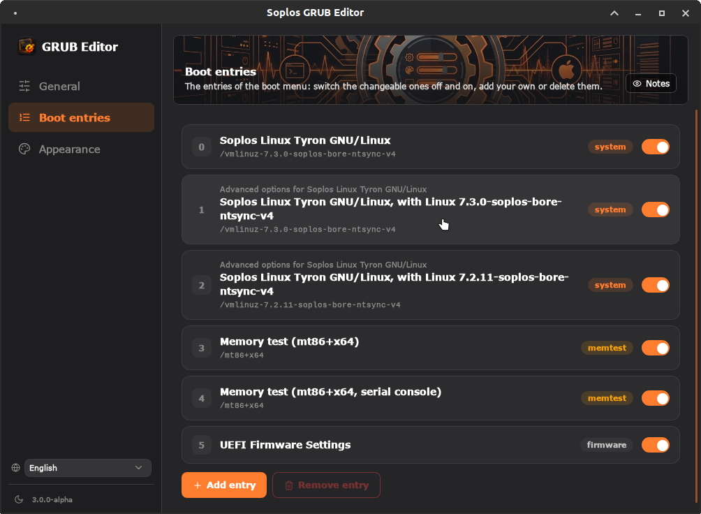
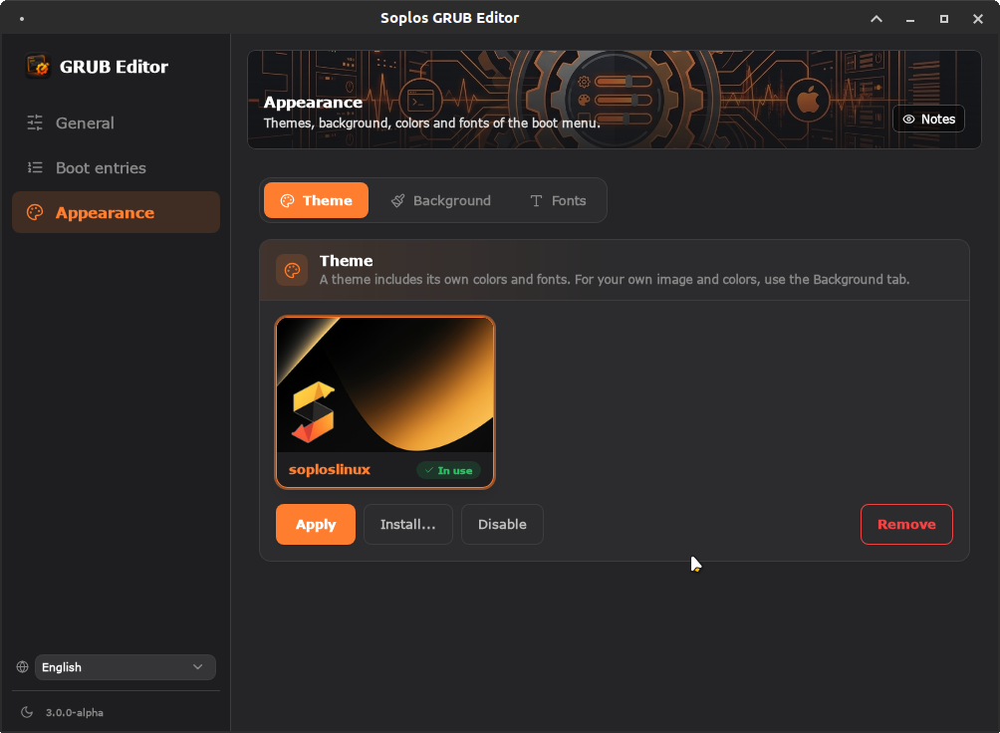
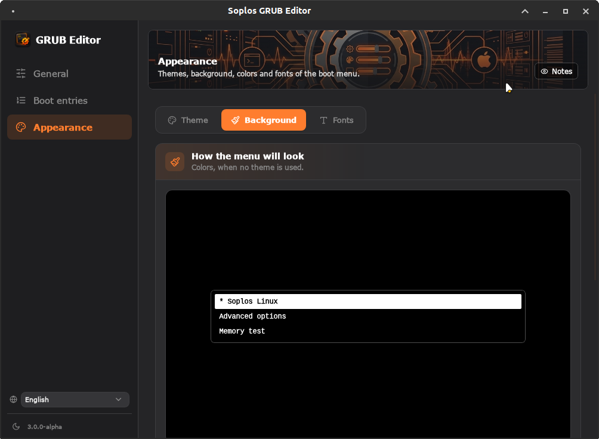
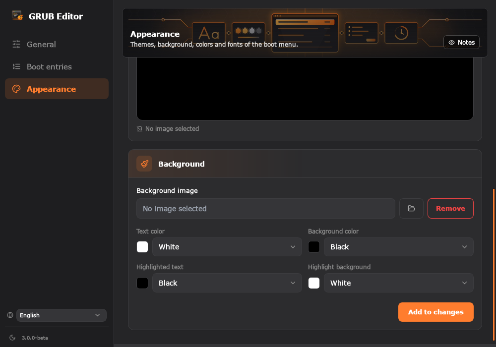
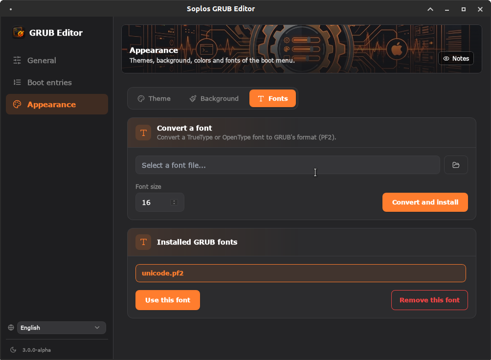

# Soplos GRUB Editor 3.0


Graphical editor for the GRUB boot loader of Soplos Linux.

Choose which entry boots by default and for how long the menu waits, edit the kernel parameters, switch the memtest and your own boot entries on and off, and change the look of the menu with themes, backgrounds, colors and fonts.

## Screenshots

| | |
|---|---|
|  **General**: default boot mode, timeout and resolution |  **Advanced options**: what the menu detects and shows, and the kernel parameters |
|  **Boot entries**: every entry of the menu, with a switch for the ones that can be changed |  **Themes**: the installed themes, with the one in use marked |
|  **Menu preview**: how the menu will look with the chosen colors |  **Background**: image and colors of the menu |
|  **Fonts**: convert a font to GRUB's format and choose it |  |

## Architecture

Version 3.0 is a ground-up rewrite of Soplos GRUB Editor. The original app was written in Python 3 with GTK3 (PyGObject) and ran its whole window as root. This rewrite replaces that stack with Tauri 2: a Rust backend and a Svelte 4 + Tailwind CSS frontend, rendered through the system's WebKitGTK.

- **Backend** (`src-tauri/`): everything that changes the boot files runs through a single polkit-gated helper (`src-tauri/src/commands/privileged.rs`), authorized by `resources/polkit/org.soplos.grubeditor.policy`. The window sends a list of named operations; the helper accepts only that closed list, checks every value again as root and runs each one with a fixed command line, never through a shell. `/etc/default/grub` is read by a shell as root when GRUB builds its menu, so the helper refuses any value that could run a command, and checks that the new file is valid shell before it replaces the old one. Every file is written whole to a temporary file and renamed over the old one, so a failure never leaves half a file. Custom entries are checked with `grub-script-check` before they are written, and theme archives are unpacked as root in a private folder and refused if they hold anything but plain files.
- **Frontend** (`src/`): three views (General, Boot Entries and Appearance), the notes panel, shared dialogs and the 8-language dictionaries under `src/i18n/`.
- **Privileges**: root actions require authentication through Polkit; the window itself never runs as the superuser.

## Installation

```bash
sudo apt install soplos-grub-editor
```

## Features

- **Default boot entry**: a fixed entry, the last installed kernel, or the last booted one. The entry is only written when it is chosen: opening the page and applying never pins the default to the current kernel.
- **Menu settings**: timeout, screen resolution, detection of other operating systems, recovery entries, use of UUIDs, submenus and the kernel parameters.
- **Boot entries**: the entries of the menu, submenus included. The memtest entries and the ones written to `/etc/grub.d/40_custom` can be switched off, switched on and deleted, and new custom entries are added from the same view. Kernel and operating system entries come from what is installed and are not changeable one by one.
- **Themes**: install a theme from an archive (`.zip`, `.tar.gz`, `.tar.xz`, `.tar.bz2`), apply it, disable it or remove it.
- **Background and colors**: a background image and the colors of the menu, chosen from the sixteen colors GRUB knows.
- **Fonts**: convert TrueType and OpenType fonts to GRUB's PF2 format, apply them and remove them.
- **Copy before changes**: before the first change of a session the program offers to save a copy of `/etc/default/grub` wherever the user chooses. It leaves no backup files of its own.
- **Notes**: a panel beside each page and a short line under each setting explain what it does. Off by default; the Notes button of the header (or Ctrl+I) turns them on.
- **Apply all**: nothing is written as soon as a setting is changed. The changes from every page wait in a bar at the bottom of the window, which lists them and lets each one be taken off. **Apply all** makes them together with a single password and a single `update-grub`, while a strip with a progress bar and a log that can be unfolded shows what is happening.
- **No GRUB, no changes**: on a system that does not boot with GRUB it says so and touches nothing.

## Dependencies

- `pkexec` (Polkit) for every change to the boot files, `grub-common` (or `grub2-common`) for `update-grub`, `grub-mkfont` and `grub-script-check`, and `tar` and `unzip` to unpack themes. All of them are installed with the package.
- `os-prober` is recommended, to detect other operating systems.

## Where it writes

| Path | Content |
|---|---|
| `/etc/default/grub` | GRUB settings |
| `/etc/grub.d/40_custom` | Custom boot entries |
| `/etc/grub.d/20_memtest86+` | Memtest entries, switched off and on |
| `/etc/grub.d/05_debian_theme`, `05_soplos_theme` | Turned off when a theme or a custom look is applied, so they do not override it |
| `/boot/grub/themes/` | Installed themes |
| `/boot/grub/fonts/` | Converted fonts |
| `/boot/grub/custom.cfg` | Colors of the custom appearance |

Nothing is written without administrator authentication, and the window itself never runs as root.

## Keyboard shortcuts

| Shortcut | Action |
|---|---|
| F1 | Open About dialog |
| Ctrl+I | Show or hide the notes |
| Ctrl+Q | Quit application |
| Ctrl+Tab | Next section |
| Ctrl+Shift+Tab | Previous section |

## Documentation

A Unix manual page is included and installed with the package:

```bash
man soplos-grub-editor
```

## Languages

The interface is available in 8 languages: English, Español, Deutsch, Français, Italiano, Português, Română and Русский. It starts in the system language and falls back to English.

## Building

```bash
npm install
npm run tauri dev      # development
./package.sh           # builds the .deb and moves it to ~/Descargas/SoplosApps
```

## License

Copyright © 2026 Sergi Perich <info@soploslinux.com>. Published under the GPL-3.0-or-later license. See `LICENSE`.
